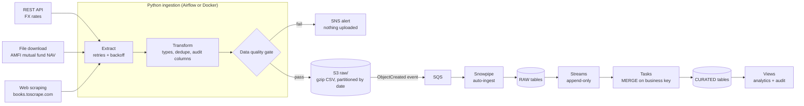

# Multi-Source Ingestion Pipeline: Python → S3 → Snowpipe → Snowflake


A cloud-native ELT pipeline that pulls data from **three different kinds of source** (REST API, flat-file download, web scraping),
cleans and validates it in Python, lands it in **S3**, and loads it into **Snowflake** with **Snowpipe auto-ingest**, then maintains
curated tables using **Streams and Tasks** (MERGE-based CDC).

It is built around problems production pipelines actually face: retries, schema drift, bad data, duplicate files, re-runs,
least-privilege security, alerting and cost control.

## Architecture



**Orchestration split:** Airflow (or any scheduler) only runs the extract/validate/upload stage. Loading is event-driven inside
Snowflake, so a slow warehouse can never block ingestion and Airflow needs no warehouse access.

## Data sources

| Source | Type | What it demonstrates |
|---|---|---|
| Frankfurter FX rates | REST API (JSON) | Time-series payload parsing, retries with backoff, look-back window |
| AMFI mutual fund NAV | Delimited text download | Parsing a messy file with section headers, missing values (`N.A.`), date parsing |
| books.toscrape.com | HTML scraping | robots.txt compliance, rate limiting, identifying User-Agent, selector-drift detection |

All sources are public. The scraping target is a sandbox site designed for scraping practice. If you point the scraper elsewhere,
read that site's terms and robots.txt first.

## Key design decisions

| Concern | Approach |
|---|---|
| **Idempotency** | Files get unique names per run (Snowpipe skips repeated file names for 14 days). Duplicates are resolved downstream by `MERGE` on business keys with `QUALIFY ROW_NUMBER()`, so re-running a day is safe. |
| **Skip no-op updates** | Every row carries a SHA-256 `row_hash`; MERGE only updates when the hash changed. |
| **Bad data never lands** | A data-quality gate (schema, row count, nulls, duplicate keys, value ranges, freshness) runs before upload. Failures raise an SNS alert and nothing is written. |
| **Failure isolation** | One source failing does not stop the others. Exit code is non-zero if any source failed. |
| **Scraper drift** | A scrape that returns almost no rows (layout changed) fails the `min_rows` rule instead of loading an empty file. |
| **Event-driven load** | S3 → SQS → Snowpipe, no polling jobs. Streams + `SYSTEM$STREAM_HAS_DATA` mean tasks cost nothing when idle. |
| **Auditability** | `source_system`, `run_id`, `ingested_at`, `file_name`, `loaded_at` on every raw row; a per-run manifest in S3; `AUDIT.V_LOAD_RECONCILIATION` to prove row counts end to end. |
| **Security** | No keys in code. Snowflake reads S3 through a storage integration (IAM role + external ID). The writer policy only allows `PutObject` on two prefixes. Bucket is private with default encryption (SSE-S3). |
| **Cost control** | XSMALL warehouse with 60 s auto-suspend, a resource monitor with a hard credit cap, S3 lifecycle expiry, and a teardown script. |

## Repository layout

```
ingestion/            Python package
  extractors/         fx_api.py, amfi_nav.py, books_scraper.py
  transform.py        cleaning + audit columns (column order is the contract with Snowpipe)
  quality.py          data-quality rules and gate
  loader.py           gzip CSV serialisation, S3 upload, manifest
  pipeline.py         source registry and per-source flow
  main.py             CLI
sql/                  01 setup → 07 monitoring, 99 teardown
aws/                  IAM policies, S3 event notification, lifecycle rules
scripts/              setup_aws.sh, create_snowflake_role.sh
dags/                 Airflow DAG (one task per source)
tests/                offline unit tests (no network, no AWS)
```

## Quick start (no AWS or Snowflake needed)

```bash
python -m venv .venv && source .venv/bin/activate
make install
make test
python -m ingestion.main --dry-run          # fetches the real sources, writes files under ./out
```

`--dry-run` produces exactly the files that would be uploaded:

```
out/raw/fx_rates/dt=2026-01-15/fx_rates_<run_id>.csv.gz
out/raw/mf_nav/dt=2026-01-15/mf_nav_<run_id>.csv.gz
out/raw/books/dt=2026-01-15/books_<run_id>.csv.gz
out/manifests/dt=2026-01-15/<run_id>.json
```

If a source API changes its URL or parameters, set the matching variable in `.env.example` (`FX_API_BASE`, `AMFI_NAV_URL`, ...).

## Full deployment

**Prerequisites:** AWS account + CLI, Snowflake account (a free trial works), Python 3.11+.

1. **AWS bucket, alerts, policies**
   ```bash
   BUCKET=<your-bucket> REGION=ap-south-1 ALERT_EMAIL=<you@example.com> ./scripts/setup_aws.sh
   ```
   Attach `build/pipeline_writer_policy.json` to the identity that runs the pipeline.
2. **Snowflake base objects:** edit the `<ACCOUNT_ID>` / `<BUCKET>` placeholders, then run `sql/01_setup.sql`. From `DESC INTEGRATION S3_INT` copy `STORAGE_AWS_IAM_USER_ARN` and `STORAGE_AWS_EXTERNAL_ID`.
3. **IAM role for Snowflake**
   ```bash
   BUCKET=<your-bucket> SF_IAM_USER_ARN=<arn> SF_EXTERNAL_ID=<id> ./scripts/create_snowflake_role.sh
   ```
4. **Tables, curated layer, pipes:** run `sql/02_raw_tables_and_streams.sql`, `03_curated_tables.sql`, `04_pipes.sql`.
5. **Wire S3 events to Snowpipe:** from `SHOW PIPES` copy the `notification_channel` (an SQS ARN) into `aws/s3_event_notification.json` (replace `<SNOWPIPE_NOTIFICATION_CHANNEL_ARN>`), then:
   ```bash
   aws s3api put-bucket-notification-configuration --bucket <your-bucket> \
     --notification-configuration file://aws/s3_event_notification.json
   ```
   This call replaces any existing notification configuration on the bucket.
6. **Start the CDC tasks:** run `sql/05_streams_tasks_merge.sql` and `sql/06_audit_and_analytics.sql`.
7. **Run the pipeline**
   ```bash
   export S3_BUCKET=<your-bucket> AWS_REGION=ap-south-1 SNS_TOPIC_ARN=<arn>
   python -m ingestion.main
   ```
   Or deploy `dags/ingestion_dag.py` to Airflow, or run the container: `docker build -t multi-source-ingestion . && docker run --rm -e S3_BUCKET -e AWS_REGION multi-source-ingestion --dry-run`
   (pass AWS credentials through an IAM role or environment for non-dry runs).
8. **Verify**
   ```sql
   SELECT * FROM INGEST_DB.AUDIT.V_LOAD_RECONCILIATION ORDER BY last_loaded_at DESC;
   SELECT * FROM INGEST_DB.CURATED.VW_FX_DAILY_CHANGE ORDER BY rate_date DESC LIMIT 20;
   ```
   Operational queries are in `sql/07_monitoring.sql`.

When finished, run `sql/99_teardown.sql` and delete the bucket to stop all spend.

## Testing

Unit tests run offline: parsers (API payloads, NAV text, HTML), transforms (types, dedupe, hashing), the data-quality gate
(empty, negative, stale, schema drift, scraper returning no rows) and the loader. CI runs `ruff` and `pytest` on every push.

## Results (fill in from your own run)

| Metric | Value |
|---|---|
| Sources / formats | 3 (API, text file, HTML) |
| Rows per daily run (fx / nav / books) | _your numbers_ |
| End-to-end latency, upload → curated | _measure from COPY_HISTORY and TASK_HISTORY_ |
| Snowflake credits for a week of runs | _from PIPE_USAGE_HISTORY and warehouse metering_ |

## Limitations and roadmap

- Add SFTP and e-mail-attachment sources (the extractor interface is already pluggable).
- Infrastructure as code (Terraform) for the AWS and Snowflake objects.
- SCD Type 2 history for the books dimension.
- Move the extraction stage to a container on ECS/Fargate or Lambda for serverless scheduling.

## License

MIT
